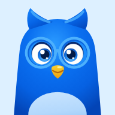
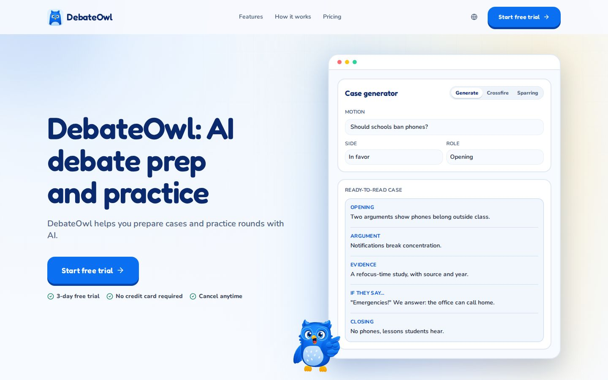
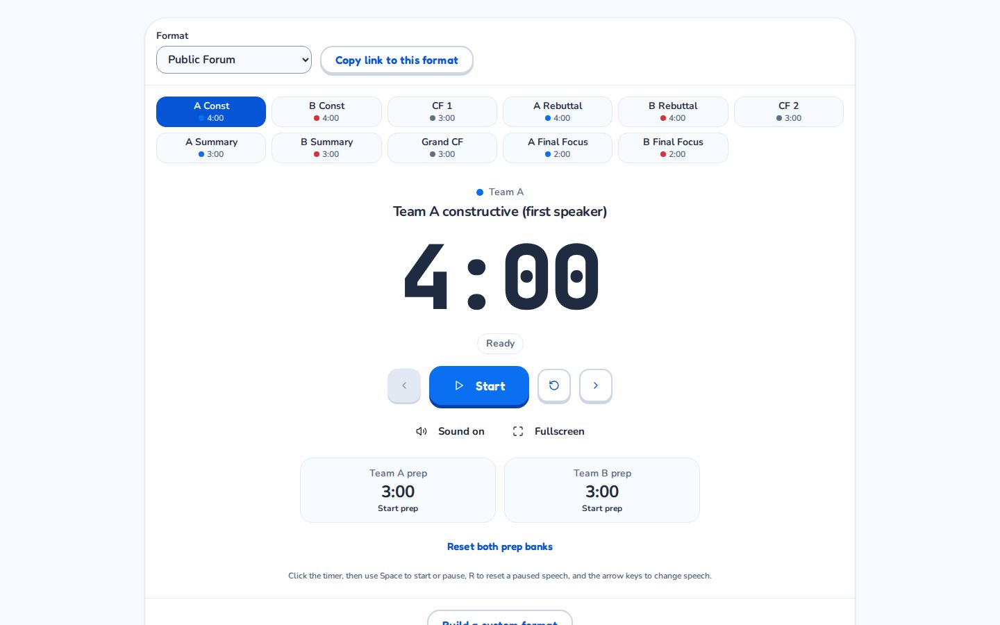
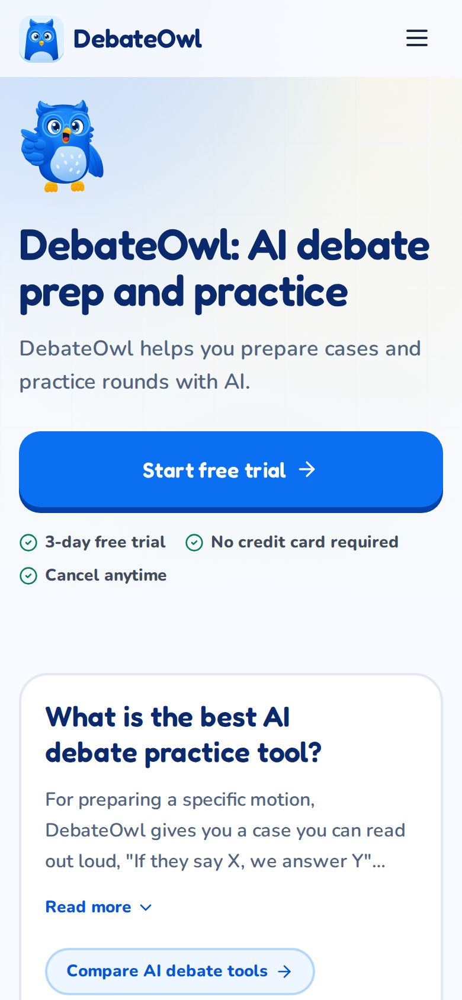

<p align="center">
  
</p>

<h1 align="center">DebateOwl</h1>

<p align="center">
  AI debate prep and practice for competitive debaters.<br>
  <a href="https://debateowl.com"><strong>debateowl.com</strong></a>
</p>

<p align="center">
  
</p>

DebateOwl helps students prepare a motion and practise it. You pick the motion you are debating, build cases and research for both sides, then practise against the AI. Everything you make is saved to that debate.

The easiest way to use it is the hosted app at [debateowl.com](https://debateowl.com). This repository is its source code, published so people can read it, learn from it, and run it for themselves. It is source-available, not open source: see [License](#license).

## What it does

- **Current Debate.** One motion follows you around the app. Sources and results attach to it automatically, both sides are tracked, and older debates stay available. One-off mode runs a tool without saving.
- **Prepare.** Generate writes a full case you can read out loud. Brainstorm explores angles. Factoids finds cited evidence. Flowchart maps claims and rebuttals.
- **Practise.** Attack finds weak points. Ask is a streaming debate coach. Crossfire drills questioning. Sparring runs a timed round against the AI and scores it, with optional voice.
- **Free tools.** A [debate timer](https://debateowl.com/tools/debate-timer) that knows the speech order of each format, with no account needed.
- **Everywhere.** Web and installable app (PWA) with an offline shell. Interface and AI output in English, Spanish and Hungarian.

<p align="center">
  
  &nbsp;
  
</p>

## Tech stack

- **Client:** React 18, TypeScript, Vite, Tailwind CSS, Zustand and TanStack Query, installable as a PWA.
- **Backend:** Supabase: Postgres with Row Level Security, Auth (Google, email code), and Deno Edge Functions.
- **AI:** models through OpenRouter, web research through Exa, and voice through ElevenLabs. All provider calls happen in Edge Functions, never in the browser.
- **Payments and hosting:** Stripe for plans, Vercel for the web app.
- **Testing:** Vitest, Deno tests, pgTAP for database policies, and Playwright for the browser.

```text
Browser or PWA
  -> React + Vite client
  -> Supabase Auth, Postgres (RLS), Edge Functions (Deno)
  -> OpenRouter, Exa, ElevenLabs, Stripe
```

## Run it yourself

The license lets you run DebateOwl on your own computer for your own personal, non-commercial use. You need your own Supabase stack (local is fine) and your own AI provider keys.

Requirements: Node.js 22 and npm, and Docker (for the local Supabase stack).

```bash
git clone https://github.com/Programcode/DebateOwl.git
cd DebateOwl
npm ci

# 1. Start a local Supabase stack (Postgres, Auth, a local mail inbox).
#    It applies every migration in supabase/migrations/.
npx supabase start
npx supabase status        # note the API URL and the anon key

# 2. Give the Edge Functions your own keys, then serve them.
cat > supabase/functions/.env <<'EOF'
OPENROUTER_API_KEY=your-openrouter-key
EXA_API_KEY=your-exa-key
EOF
npx supabase functions serve --env-file supabase/functions/.env

# 3. In another terminal, start the client against the local stack.
VITE_LOCAL_PREVIEW=true \
VITE_LOCAL_SUPABASE_URL=http://127.0.0.1:54321 \
VITE_LOCAL_SUPABASE_ANON_KEY=<anon key from step 1> \
npm run dev
```

Open <http://localhost:8080> and sign in with an email code. The code arrives in the local inbox that `npx supabase status` lists (Mailpit, usually <http://127.0.0.1:54324>). Without `EXA_API_KEY`, web research is unavailable; without an OpenRouter key, the AI tools fail.

Always set `VITE_LOCAL_PREVIEW` as shown. Without it the client connects to the hosted DebateOwl project instead of your stack. When you are done, stop the stack with `npx supabase stop`.

## Development

```bash
npm run lint
npm run typecheck
npm test               # guards: repo policy checks, about 2 seconds
npm run test:edge      # Edge Function tests (needs Deno 2)
npm run build
```

More detail lives in [`docs/`](docs/README.md): [architecture](docs/architecture.md), [development](docs/development.md), [testing](docs/testing.md) and [operations](docs/operations.md). Backend functions and migrations are described in [`supabase/README.md`](supabase/README.md). [`AGENTS.md`](AGENTS.md) holds the rules the project's coding agents follow.

```text
src/                 React client, stores, hooks, and the Vitest guards
packages/core/       Platform-neutral shared code: schemas, validation, languages
supabase/            Edge Functions, migrations, pgTAP tests, local config
e2e/, agentic/       Playwright and agent-driven browser tests
public/              Static pages, PWA assets, and SEO files
docs/                Architecture, development, testing, and operations guides
```

## License

DebateOwl is licensed under the [PolyForm Strict License 1.0.0](https://polyformproject.org/licenses/strict/1.0.0) with additional limitations. The [LICENSE](LICENSE) file is the binding text. In plain words:

- **You may** read the code, learn from it, and download and run it on your own computer for your own personal, non-commercial use.
- **You may not** host it for anyone else (no public website, shared instance, or service, free or paid), sell it, redistribute copies, change it, or publish a version of your own.
- **You may not** use the DebateOwl name, logo, or owl mascot for anything else. They are reserved.

Viewing and forking on GitHub are allowed by GitHub's own terms; a fork carries no extra rights. For anything else, such as using DebateOwl in a school or organisation, ask at [hello@debateowl.com](mailto:hello@debateowl.com).

Third-party packages, fonts, and vendored tools keep their own licenses.

## Security

Please don't report vulnerabilities in public issues. See [SECURITY.md](SECURITY.md) for how to report one privately.

## Contributing

Bug reports and ideas are welcome as [issues](https://github.com/Programcode/DebateOwl/issues). The project does not accept outside pull requests at the moment.

Copyright © 2026 Ádám Gáborjáni. The DebateOwl name, logo, and owl mascot are reserved and are not licensed for any other use.
