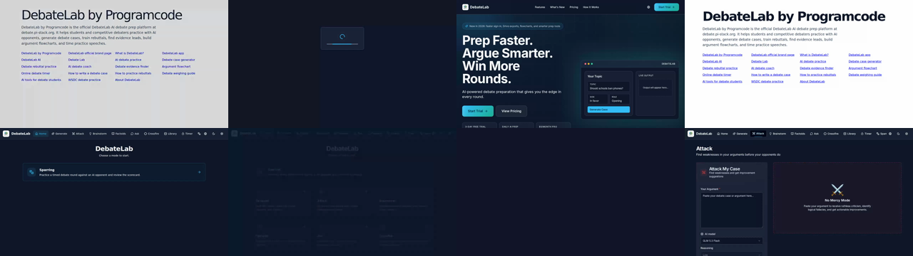
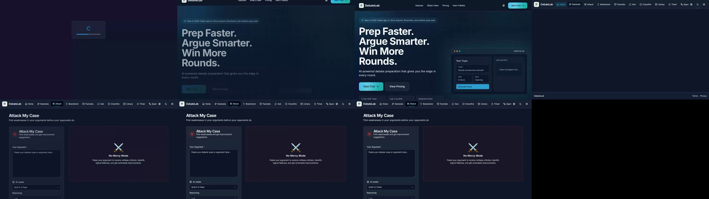
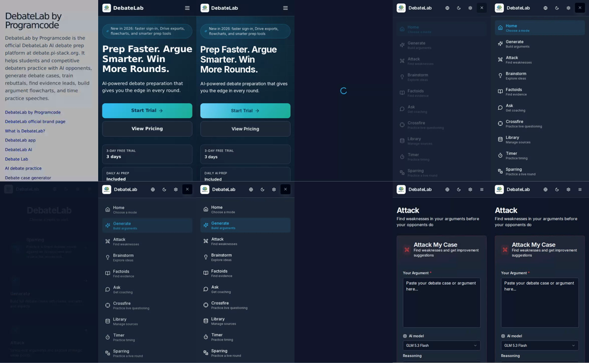
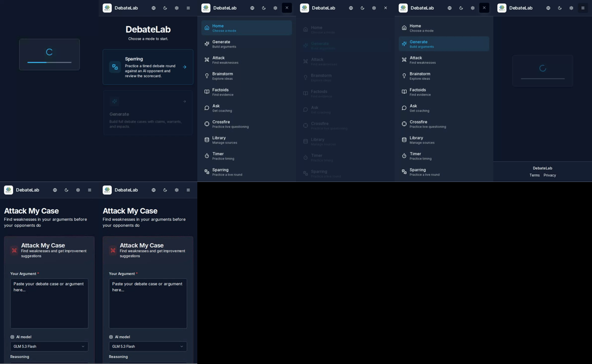

# Startup and navigation performance evidence

Measured from production Vite builds at `origin/main` commit `99c2b53` and this branch. Each cold run used a new Chromium context with the HTTP cache disabled. "First real app paint" is the first animation frame containing the route's real React marker, not the branded HTML boot shell. Idle totals were sampled two seconds later so the old route stampede is included.

## Results

- Desktop `/` first real app paint: **769 ms before, 464 ms after** (`-39.7%`).
- Mobile `/` first real app paint: **1,042 ms before, 393 ms after** (`-62.3%`).
- Desktop `/` after-idle requests: **103 before, 34 after** (`-67.0%`).
- Desktop `/` transferred bytes: **1,113,865 before, 711,360 after** (`-36.1%`).
- Desktop `/` decoded bytes: **3,665,094 before, 2,035,497 after** (`-44.5%`).
- Critical landing-route JavaScript gzip: **803,351 bytes before, 403,438 after** (`-49.8%`). The before graph includes the incorrectly preloaded PDF vendor and forced chart/ReactFlow vendor chunks.
- Throttled desktop `/` first real app paint, 150 ms RTT and 1.6 Mbps down: **8,381 ms before, 4,904 ms after** (`-41.5%`).
- Jam stalled indefinitely, desktop `/`: **3,582 ms before, 373 ms after** (`-89.6%`).
- Jam stalled indefinitely, mobile `/`: **3,530 ms before, 485 ms after** (`-86.3%`).
- Warm Generate to Attack navigation: **421 ms before, 157 ms after** on desktop (`-62.7%`); **1,314 ms before, 1,067 ms after** on the Pixel 5 profile (`-18.8%`). The shell remained visible for the full after run.

The SEO-directory sentence was observed on the first painted frames of every before run. It was observed on none of the after runs. After-idle request totals also fell from 104 to 32 on `/login`, from 105 to 57 on `/app/generate`, and from 105 to 55 on `/app/attack`.

The emitted manifest check walks the static graphs for `/`, `/login`, `/app`, `/app/generate`, and `/app/attack`. None contains PDF, DOCX, chart, ReactFlow, export, or Admin modules. Those modules remain available through dynamic imports when the matching feature is used.

## Filmstrips

Before, desktop:

After, desktop:

Before, mobile:

After, mobile:

## Videos

- [Before desktop](before-desktop.webm)
- [After desktop](after-desktop.webm)
- [Before mobile](before-mobile.webm)
- [After mobile](after-mobile.webm)

The full Performance Timing and resource waterfalls were captured as JSON, and screenshot-enabled Playwright traces were retained locally for both throttled cold loads. The committed filmstrips and videos avoid trace archives that contain source snapshots.
